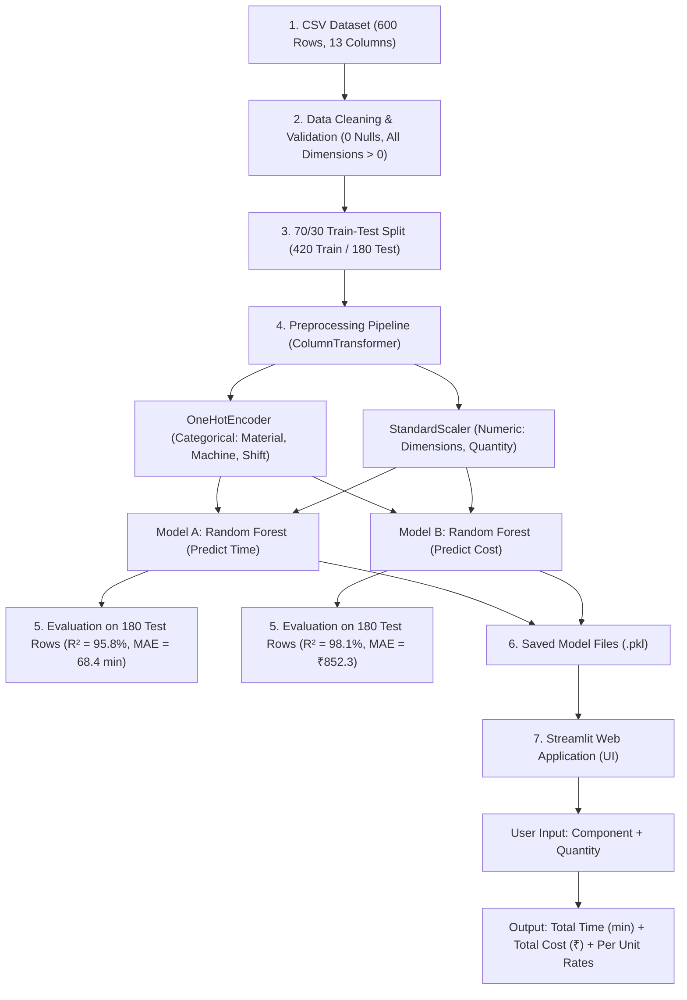

# Complete Project Explanation & College Viva Guide

**Project Title:** Machine Learning-Based Component-Wise Manufacturing Time and Cost Prediction for Laptops  
**Language:** Python | **Libraries:** Scikit-Learn, Pandas, NumPy, Streamlit, Plotly  

---

## 📌 PART 1: ZERO TO ADVANCE NOTES (Samajhne Ke Liye)

### 1. Basic Level: Project Kya Hai? (In 2 Lines)
Laptop banane me har component (jaise casing, RAM, motherboard) ko banane ya lagane me **kitna time (minutes)** aur **kitna kharcha (INR ₹)** aayega, yeh hamara **Machine Learning model** predict karta hai.

---

### 2. Yeh Project Kyu Banaya? (Real-World Problem)
Jab koi factory laptop banati hai, toh unhe pehle se plan karna hota hai:
* Agar hum 100 laptops ka casing banayein toh machine kitne ghante chalegi?
* RAM aur SSD install karne me workers ka kitna labor time lagega?
* Total batch ka budget kitna hoga?

Pehle log manually estimate lagate the jo aksar galat hota tha. Is project me **Machine Learning** purane 600 production batches ke data se seekhkar accurate prediction karta hai.

---

### 3. Manufacturing vs Assembly Me Kya Antar Hai? (Very Important)
College examiner sabse pehle yahi puchega:
* **1. Manufacturing Components:**
  * Inhe factory me raw material se physically banaya jata hai.
  * *Examples:* Laptop Casing (Plastic/Aluminum ko shape dena), Laptop Hinges (Steel stamping), Heat Sink (Aluminum cutting).
* **2. Assembly Operations:**
  * Complex electronics hum factory me nahi banate, hum market se khareed kar laptop me fit/assemble karte hain.
  * *Examples:* RAM Installation, SSD Installation, Motherboard Installation, Battery Connection, Thermal Paste lagana.
  * *(Examiner ko bolna: Sir, hum RAM ya SSD manufacture nahi karte, unhe motherboard me install/assemble karte hain!)*

---

### 4. Input Features (X) Aur Output Targets (y) Kya Hain?
* **Input Features (11 cheezein):**
  1. `Component_Type`: Kaunsa part hai (e.g. Laptop Casing, RAM).
  2. `Process_Type`: Manufacturing hai ya Assembly.
  3. `Material`: Plastic, Aluminum, Steel, Purchased Electronics.
  4. `Length_mm`: Part ki lambai.
  5. `Width_mm`: Part ki chaudai.
  6. `Height_mm`: Part ki motai (thickness).
  7. `Production_Quantity`: Kitne piece banane hain (e.g. 10, 50, 100).
  8. `Manufacturing_Process`: Injection Molding, CNC Machining, Slot Insertion, etc.
  9. `Complexity_Level`: Design kitna complex hai (1.0 se 1.4 tak).
  10. `Machine_Type`: Kaunsi machine use ho rahi hai.
  11. `Shift_Type`: Day shift hai ya Night shift.
* **Output Targets (2 cheezein):**
  * **Model A:** `Actual_Time_Minutes` (Total kitne minute lagenge).
  * **Model B:** `Actual_Cost_INR` (Total kitna kharcha aayega).

---

### 5. Intermediate Level: Data Preprocessing (Model Train Karne Se Pehle)
Machine Learning models text (words) nahi samajhte, sirf numbers samajhte hain. Isliye humne **Pipeline** banayi:
1. **One-Hot Encoding (OHE):**
   * Text columns jaise `Material`, `Machine_Type`, `Shift_Type` ko 0 aur 1 (binary numbers) me convert kiya.
   * `handle_unknown='ignore'` use kiya taaki agar koi naya input aaye toh app crash na ho.
2. **StandardScaler:**
   * Dimensions aur Quantity ke numbers ka scale alag hota hai (e.g., Quantity = 100, Height = 3mm). Scaler sabko standard range me lata hai.
3. **Train-Test Split (70/30):**
   * 600 rows me se **70% (420 rows)** model ko padhane (train karne) ke liye di.
   * Baki **30% (180 rows)** chupake rakhi (test set) taaki model ka exam le sakein.

---

### 6. Advance Level: Random Forest Regressor Hi Kyu Chuna?
* **Linear Regression Kyu Fail Hua?**
  * Linear regression seedhi line assume karta hai. Lekin factory me Aluminum ko CNC se kaatne me plastic molding ke mukable non-linear time lagta hai. Isliye Linear Regression ka score sirf 67% aaya.
* **Random Forest Kaise Kaam Karta Hai?**
  * Yeh **100 Decision Trees** ka jungle (forest) banata hai.
  * Har tree alag-alag data samples aur features par seekhta hai.
  * Jab hum prediction maangte hain, toh saare 100 trees ka average (mean) nikal kar final answer deta hai.
  * Isse accuracy badh gayi aur overfitting ruk gayi!

---

### 7. Evaluation Metrics (Accuracy Kaise Check Ki?)
Examiner puchega: *"Regression me Accuracy % kyu nahi nikaala?"*
* **Answer:** Classification me discrete categories hoti hain (Cat vs Dog), wahan accuracy % hota hai. Lekin Regression me continuous numbers (e.g. 125.43 minutes) hote hain, isliye distance error dekhte hain:
1. **MAE (Mean Absolute Error):** Actual aur Predicted ka average antar. (Hamare model me time ka average error sirf 68 minutes hai 200 units ke batch par).
2. **RMSE (Root Mean Squared Error):** Bade errors ko zyada penalty deta hai.
3. **R² Score (Accuracy Score):** Model ne data ka kitna variance explain kiya.
   * **Time Model R²:** **0.9585 (95.8%)**
   * **Cost Model R²:** **0.9807 (98.1%)**

---

## 🔄 PART 2: FLOW DIAGRAM (SYSTEM ARCHITECTURE)

---

## 🎓 PART 3: TOP 15 COLLEGE VIVA QUESTIONS & ANSWERS

### Q1: Aapke project ka main objective kya hai?
**Answer:** "Sir, hamare project ka objective laptop manufacturing aur assembly operations ke liye required time aur cost ko accurately predict karna hai using Random Forest regression."

### Q2: Is project me kitne Machine Learning models use huye hain?
**Answer:** "Sir, 2 separate regression models hain:
* Model 1: `Actual_Time_Minutes` predict karta hai.
* Model 2: `Actual_Cost_INR` predict karta hai."

### Q3: Regression aur Classification me kya fark hai?
**Answer:** "Classification me output categorical classes hoti hain (jaise Spam / Not Spam, Defective / Non-Defective). Regression me output continuous numerical value hoti hai (jaise yahan Minutes aur Rupees). Isliye humne regression algorithms use kiye hain."

### Q4: Aapne Random Forest Regressor hi kyu choose kiya?
**Answer:** "Sir, humne pehle Linear Regression try kiya tha, jiska R² score sirf 0.67 aaya tha. Manufacturing me parameters ke beech non-linear relationships hote hain (jaise material, machine aur volume ka aapas me relation). Random Forest ek ensemble model hai jo 100 decision trees ka average lekar non-linear patterns ko accurately capture karta hai, jisse hamara R² score 95.8% aur 98.1% tak pahunch gaya."

### Q5: Dataset me total kitne rows aur columns hain?
**Answer:** "Sir, total 600 rows aur 13 columns hain. 11 input features hain aur 2 target columns (Time aur Cost) hain."

### Q6: 70/30 train-test split kyu kiya?
**Answer:** "Sir, model ki real-world performance check karne ke liye. 70% data (420 rows) par model ko train kiya gaya hai, aur 30% data (180 rows) ko alag rakha gaya taaki model unseen data par test ho sake aur hum overfitting check kar sakein."

### Q7: Data Leakage kya hota hai aur aapne kaise bachaya?
**Answer:** "Data leakage tab hota hai jab testing data ki information training phase me leak ho jaaye, jisse fake high accuracy aati hai. Humne train-test split preprocessing se pehle kiya, aur OneHotEncoder aur Scaler ko strictly training data par hi fit kiya."

### Q8: R² Score kya represent karta hai?
**Answer:** "R² score (Coefficient of Determination) batata hai ki hamare features target variable ke kitne percent variance ko explain karte hain. Hamare model ka R² score 0.958 (Time) aur 0.980 (Cost) hai, matlab >95% accurate prediction ho rahi hai."

### Q9: MAE aur RMSE me kya difference hai?
**Answer:** 
* **MAE (Mean Absolute Error):** Actual aur predicted ka seedha average difference batata hai (raw units me).
* **RMSE (Root Mean Squared Error):** Errors ka square karke average nikaalta hai, isliye yeh bade outliers ko zyada penalty deta hai.

### Q10: Kya aapka model per-unit time predict karta hai ya total batch ka?
**Answer:** "Sir, dataset inspect karne par pata chala ki Time aur Cost batch quantity ke saath scale karte hain. Isliye hamara model seedha total batch time aur cost predict karta hai. Unit rate nikalne ke liye hum batch prediction ko quantity se divide karte hain, jisse double-multiplication error nahi hota."

### Q11: RAM aur SSD manufacturing me aate hain ya assembly me?
**Answer:** "Sir, Assembly me. Hum complex electronics jaise RAM, SSD aur Motherboard market se purchase karte hain. Unhe laptop chassis me mount aur connect karne ko assembly operation kehte hain."

### Q12: One-Hot Encoding kyu use ki?
**Answer:** "Machine learning algorithms strings ya text nahi samajhte. Material (Plastic, Aluminum) aur Machine Type jaise categorical columns ko binary numeric columns (0 aur 1) me convert karne ke liye One-Hot Encoding use ki."

### Q13: Agar user koi naya ya anjaan component daal de toh kya app crash hogi?
**Answer:** "Nahi sir, humne `OneHotEncoder(handle_unknown='ignore')` use kiya hai. Agar koi anjaan category aati hai toh model bina crash huye safely 0 assign karke prediction deta hai."

### Q14: Dataset real factory ka hai ya synthetic?
**Answer:** "Sir, industrial production parameters proprietary hote hain. Yeh dataset realistic shop-floor constraints aur physics ko replicate karne ke liye synthetically simulate kiya gaya sample data hai."

### Q15: Streamlit kya hai aur aapne frontend ke liye kyu chuna?
**Answer:** "Streamlit ek modern Python open-source framework hai jisse machine learning models ke liye clean, interactive web applications bina HTML/CSS/JS ke direct Python code se banayi ja sakti hain."
