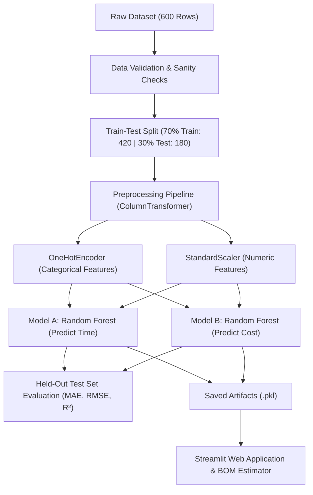

# Machine Learning-Based Component-Wise Manufacturing Time and Cost Prediction for Laptops

> **Academic College Mini-Project**  
> **Course:** 5th Semester, B.Tech / B.E. in Computer Science & Engineering (CSE)  
> **Domain:** Applied Machine Learning & Predictive Production Engineering  

---

## 📌 1. Project Introduction

In modern consumer electronics manufacturing, laptops require a hybrid workflow:
1. **Primary Component Manufacturing:** Physical fabrication of structural parts (e.g., casing, hinges, cooling fans, keyboard frames, heat sinks) using industrial processes like CNC Machining, Injection Molding, and Metal Stamping.
2. **Sub-Assembly & Installation Operations:** Mounting pre-purchased electronic modules (e.g., Motherboard, RAM, SSD, Display panel, Battery, Wi-Fi card) and applying thermal paste before conducting final quality checks.

> **Important Boundary Clarification:**  
> This project does **not** claim that complex semiconductor parts (such as RAM modules, SSDs, or Motherboards) are manufactured in this facility. Rather, their installation is categorized as an **Assembly operation**, while physical enclosures and structural parts are treated as **Manufacturing operations**.

---

## 🎯 2. Problem Statement

Factory managers and estimation engineers face challenges in predicting the exact machine cycle time and manufacturing expenditure for laptop components due to:
* Variations in physical dimensions (Length, Width, Height)
* Material properties (Aluminum vs Plastic vs Steel vs Thermal Compound)
* Machine types and operational shift constraints (Day vs Night)
* Non-linear batch scaling and complexity multipliers

**The Solution:** An end-to-end Machine Learning pipeline featuring **two independent Random Forest regression models** trained on historical batch records to simultaneously predict:
* **Model A:** Process / Batch Time (`Actual_Time_Minutes`)
* **Model B:** Process / Batch Cost (`Actual_Cost_INR`)

---

## 📂 3. Dataset Description & Synthetic Data Limitation

### Primary Dataset: `laptop_manufacturing_assembly_dataset_600_rows.csv`
* **Total Records:** 600 production batches
* **Total Attributes:** 13 columns (11 Features + 2 Target Variables)
* **Data Hygiene:** 0 Missing Values, 0 Duplicate Records, 100% positive physical dimensions.

| Column Name | Data Type | Role | Description |
| :--- | :--- | :--- | :--- |
| `Component_Type` | Categorical | Feature | Name of component (17 categories: Casing, RAM, Display, etc.) |
| `Process_Type` | Categorical | Feature | Operational category (`Manufacturing` or `Assembly`) |
| `Material` | Categorical | Feature | Raw material used (Aluminum, Plastic, Steel, Purchased Electronics, etc.) |
| `Length_mm` | Numeric | Feature | Component length in millimeters (18 to 345 mm) |
| `Width_mm` | Numeric | Feature | Component width in millimeters (11 to 242 mm) |
| `Height_mm` | Numeric | Feature | Component height / thickness in millimeters (1 to 23 mm) |
| `Production_Quantity` | Numeric | Feature | Batch size (1 to 200 units) |
| `Manufacturing_Process` | Categorical | Feature | Process used (CNC Machining, Injection Molding, Slot Insertion, etc.) |
| `Complexity_Level` | Numeric | Feature | Geometry / operation factor (1.0 to 1.4) |
| `Machine_Type` | Categorical | Feature | Equipment used (CNC Machine, Assembly Workstation, Stamping Machine, etc.) |
| `Shift_Type` | Categorical | Feature | Shift during batch execution (`Day` or `Night`) |
| **`Actual_Time_Minutes`** | Numeric (Target) | **Target A** | Actual total time taken for the specified batch size |
| **`Actual_Cost_INR`** | Numeric (Target) | **Target B** | Actual total cost incurred for the specified batch size |

### ⚠️ Synthetic Data Limitation (Academic Note)
> **Academic Integrity Disclosure:**  
> Real-world laptop production figures are proprietary industrial secrets of major original equipment manufacturers (OEMs). This dataset comprises **synthetic, simulated historical production data**. While it reflects realistic engineering constraints and non-linear cost curves, the figures are intended for academic modeling and prototyping rather than commercial shop-floor quoting.

---

## ⚙️ 4. Technology Stack

* **Programming Language:** Python 3.13 / 3.10+
* **Machine Learning Library:** `scikit-learn` (`RandomForestRegressor`, `ColumnTransformer`, `OneHotEncoder`, `StandardScaler`, `Pipeline`)
* **Data Manipulation:** `pandas`, `numpy`
* **Interactive Web UI:** `streamlit`
* **Interactive Charting:** `plotly` (Express & Graph Objects)
* **Model Serialization:** `joblib`

---

## 🔄 5. System Workflow & ML Architecture



### Key Architectural Safeguards:
1. **Zero Data Leakage:** Preprocessing transformations (`OneHotEncoder` and `StandardScaler`) are fitted **only on the 70% training split (420 rows)**. The held-out test data (180 rows) is transformed without refitting.
2. **Handling Unseen Categories:** `OneHotEncoder(handle_unknown='ignore')` guarantees that novel or unexpected dropdown values in the web application will never crash the system.
3. **No Double-Multiplication:** Target values represent the **total batch figures** for the given `Production_Quantity`. The models directly predict batch time and cost; per-unit values are obtained by `batch_prediction / quantity`.

---

## 📊 6. Model Evaluation Results

Both models were evaluated strictly against the **held-out 30% test set (180 unseen samples)** with fixed `random_state=42`. A **Linear Regression Baseline** was trained on the exact same split to demonstrate the superiority of the non-linear Random Forest approach:

| Target Variable | Model Architecture | MAE (Mean Absolute Error) | RMSE (Root Mean Sq Error) | R² Score |
| :--- | :--- | :--- | :--- | :--- |
| **Time (Minutes)** | **Random Forest Regressor** | **68.49 min** | **151.50 min** | **0.9585 (95.8%)** |
| Time (Minutes) | Linear Regression Baseline | 251.38 min | 427.37 min | 0.6701 (67.0%) |
| **Cost (INR)** | **Random Forest Regressor** | **₹852.33** | **₹2,364.78** | **0.9807 (98.1%)** |
| Cost (INR) | Linear Regression Baseline | ₹7,446.00 | ₹12,798.82 | 0.4348 (43.5%) |

### Why Error Metrics (MAE, RMSE, R²) instead of Classification Accuracy?
In Machine Learning:
* **Accuracy (%)** applies strictly to **Classification** (predicting discrete labels: Yes/No, Cat/Dog).
* **Regression** predicts continuous numeric values. An exact match down to the decimal point is statistically impossible, so regression performance is measured by distance metrics (**MAE**, **RMSE**) and explained variance (**R²**).

---

## 📁 7. Project Directory Structure

```text
Production Time And Cost Predictor MINI PROJECT/
├── laptop_prediction_project/
│   ├── app.py                     # Interactive Streamlit Web Application
│   ├── train_model.py             # 70/30 Training & Evaluation Pipeline
│   ├── test_pipeline.py           # Verification & Unit Test Suite
│   ├── requirements.txt           # Project Dependencies
│   ├── README.md                  # Comprehensive Documentation
│   ├── data/
│   │   └── laptop_manufacturing_assembly_dataset_600_rows.csv
│   ├── models/
│   │   ├── time_model.pkl         # Saved Random Forest Pipeline for Time
│   │   └── cost_model.pkl         # Saved Random Forest Pipeline for Cost
│   └── outputs/
│       ├── evaluation_metrics.json # Calculated MAE, RMSE, R² scores
│       ├── feature_importances.json# Top feature drivers for Time and Cost
│       ├── metadata.json          # Unique values & component profiles
│       └── test_predictions.csv   # Actual vs Predicted records (180 samples)
├── app.py                         # Root Convenience Entrypoint
├── train_model.py                 # Root Convenience Entrypoint
└── requirements.txt               # Root Dependencies File
```

---

## 🚀 8. How to Install and Run

### Step 1: Open Terminal / PowerShell
Navigate to the project root directory:
```bash
cd "c:\Users\sachi\OneDrive\Desktop\Production Time And Cost Predictor MINI PROJECT"
```

### Step 2: Install Dependencies
```bash
pip install -r requirements.txt
```

### Step 3: Train the Models (Optional - Already Pre-Trained)
To train the models from scratch and regenerate all evaluation files:
```bash
python train_model.py
```

### Step 4: Run Verification Tests
```bash
python laptop_prediction_project\test_pipeline.py
```

### Step 5: Launch the Interactive Web Application
```bash
python -m streamlit run app.py
```
Open your web browser and navigate to:  
👉 **`http://localhost:8501`**

---

## 🖥️ 9. Web Application Features

1. **🔮 Single Component Predictor:**
   - Dropdown selection of 17 laptop parts with optional **Auto-populate Typical Specs**.
   - Adjustable sliders for batch size, physical dimensions, and complexity.
   - Real-time prediction cards displaying batch time, batch cost, and per-unit cycle rates.
2. **📋 Multi-Component BOM (Bill of Materials) Estimator:**
   - Select multiple components across the assembly line.
   - Enter individual production volumes.
   - Generates an executive cost & time breakdown table with interactive Plotly distribution charts.
3. **📊 Dataset & EDA Dashboard:**
   - High-level metric counters, distribution donuts, material bar charts, and quantity correlation plots.
   - Interactive table to filter and inspect dataset records.
4. **📈 Model Evaluation Hub:**
   - Comparison table against linear baselines.
   - Interactive 45-degree Actual vs. Predicted scatter plots.
   - Feature Importance charts ranking the top drivers of manufacturing time and cost.
5. **🎓 Viva & Theory Guide:**
   - 10 ready-to-answer external examiner questions directly built into the app interface.

---

## 🎓 10. College Viva & Examination Q&A Guide

### Q1: What is Machine Learning?
**Answer:** Machine Learning is a branch of Artificial Intelligence where software algorithms uncover mathematical patterns and decision rules directly from historical data without needing hardcoded manual logic.

### Q2: What is Regression and how is it different from Classification?
**Answer:** Regression predicts a continuous numeric value (e.g., Time in minutes, Cost in INR). Classification predicts discrete categories or classes (e.g., Pass/Fail, Spam/Not Spam). Because manufacturing time and cost are continuous numbers, this project uses regression.

### Q3: Why did you choose Random Forest Regressor over Linear Regression?
**Answer:** Production processes exhibit non-linear physical interactions. For example, milling an Aluminum casing with CNC takes exponentially more time as complexity and dimensions increase compared to stamping a steel hinge. Linear Regression only achieved an R² of 0.67 on time and 0.43 on cost. Random Forest builds 100 decorrelated decision trees and averages their outputs, capturing complex non-linear interactions and boosting R² to **> 0.95**.

### Q4: What are the input Features and prediction Targets?
**Answer:**
* **11 Features (X):** `Component_Type`, `Process_Type`, `Material`, `Length_mm`, `Width_mm`, `Height_mm`, `Production_Quantity`, `Manufacturing_Process`, `Complexity_Level`, `Machine_Type`, and `Shift_Type`.
* **2 Targets (y):** `Actual_Time_Minutes` (Model A) and `Actual_Cost_INR` (Model B).

### Q5: Why split the data into 70% Training and 30% Testing?
**Answer:** Splitting data prevents **overfitting** (a model memorizing training points). The 70% split (420 rows) allows the model to learn general patterns, while the 30% split (180 rows) acts as an unbiased, unseen examination to prove how accurately the model performs on new batches.

### Q6: What are MAE, RMSE, and R² Score?
**Answer:**
* **MAE (Mean Absolute Error):** The average absolute difference between predicted and actual values. Our time model has an MAE of 68.49 min across batches up to 200 units.
* **RMSE (Root Mean Squared Error):** The square root of squared errors, giving higher penalty to large outliers (151.50 min).
* **R² Score:** The percentage of variance explained by the model. 0.9585 means 95.85% of time variability is captured by our features.

### Q7: What is Data Leakage and how did you prevent it?
**Answer:** Data leakage occurs when test set signals or target data accidentally leak into model training. We prevented it by:
1. Performing the 70/30 split *before* fitting any scaler or encoder.
2. Fitting `ColumnTransformer` strictly on `X_train`.
3. Never using target values as features in the opposite model.

### Q8: What is the distinction between Manufacturing and Assembly here?
**Answer:**
* **Manufacturing:** Raw material transformation (e.g., melting plastic for casing, cutting aluminum heat sinks, stamping hinges).
* **Assembly:** Installing purchased finished components (e.g., screwing in a motherboard, slotting RAM or SSD, connecting display cables). We explicitly do not manufacture silicon electronics.

### Q9: Why is this dataset synthetic?
**Answer:** Industrial laptop assembly parameters are proprietary commercial trade secrets. A synthetic dataset was generated to simulate realistic shop-floor physics and cost scaling for academic demonstration.

### Q10: Does the model output per-unit or batch estimates?
**Answer:** In the dataset, `Actual_Time_Minutes` and `Actual_Cost_INR` scale proportionally with `Production_Quantity`. Thus, the models predict **total batch values**. To get per-unit rates, we divide the predicted batch total by the quantity, avoiding redundant double multiplication.

---

## 🔮 11. Limitations & Future Scope

### Limitations
1. **Synthetic Scope:** Requires calibration against actual factory time-and-motion studies prior to real industrial quoting.
2. **Dynamic Utilities:** Does not dynamically track fluctuating electric kilowatt-hour tariffs or raw material commodity spot prices.
3. **Machine Downtime:** Assumes continuous machine uptime without factoring unexpected breakdown maintenance.

### Future Scope
1. **IoT Telemetry Integration:** Connecting live MQTT feeds from factory PLC sensors.
2. **Deep Learning Line Scheduling:** Implementing LSTM / Transformer networks to dynamically schedule laptop assembly line balancing.
3. **Automated Defect & Quality Cost Forecasting:** Integrating computer vision inspection cameras to penalize rework costs in real time.
